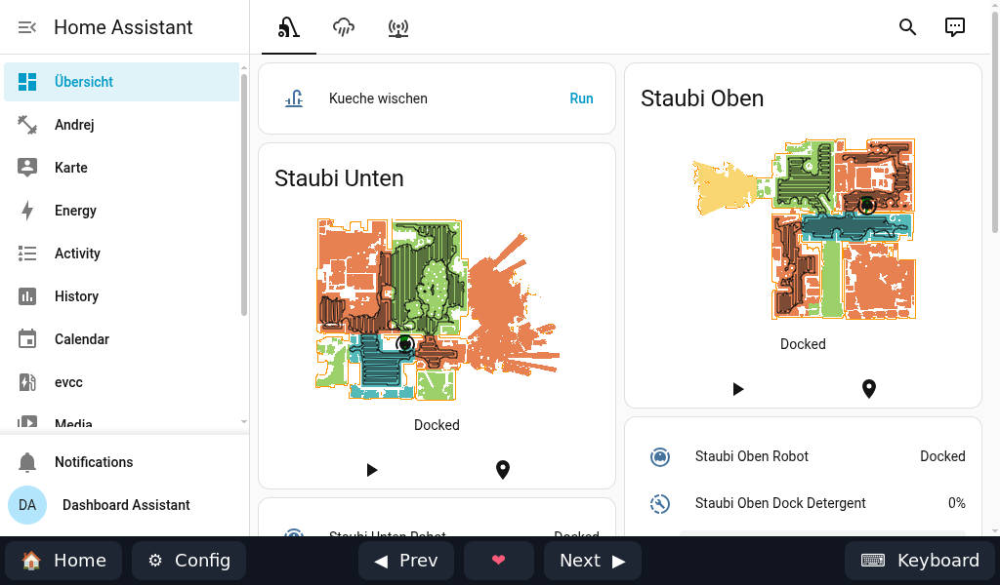
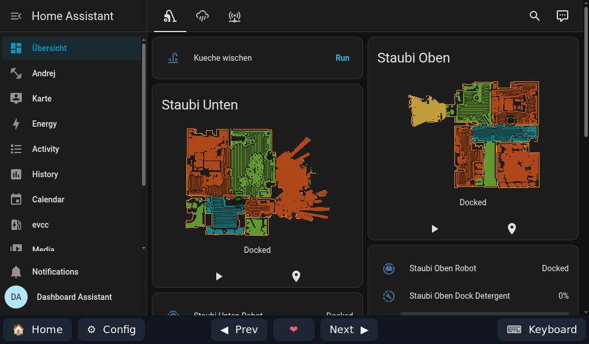
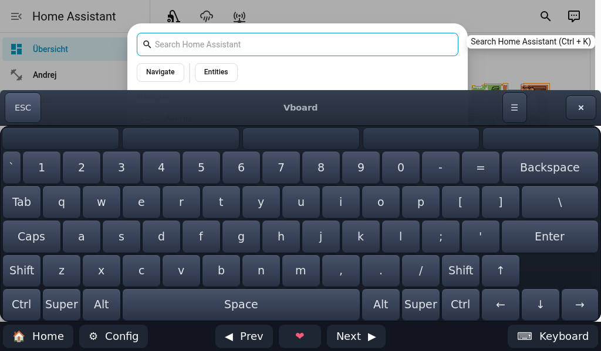
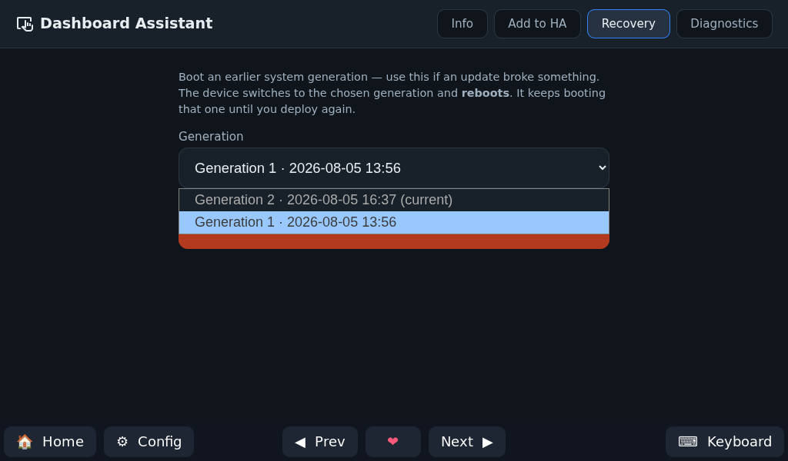
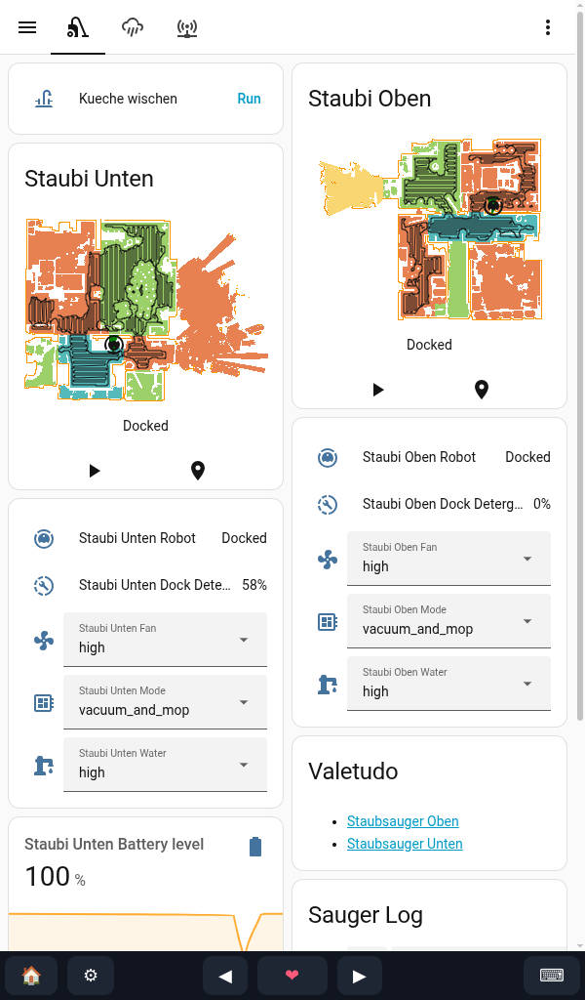
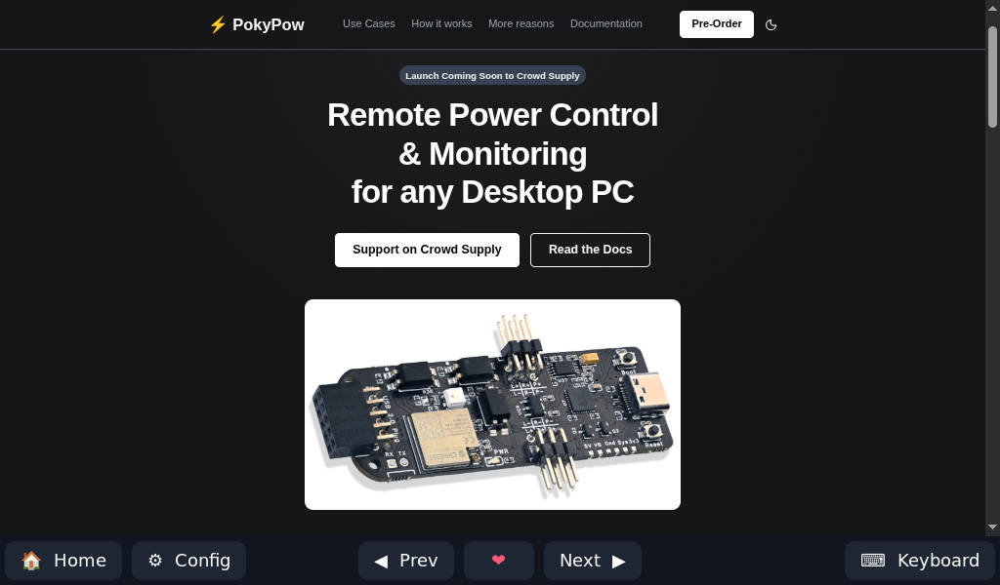

<h3 align="center"></h3>

<h3 align="center">The Best Home Assistant Tablet Experience!</h3>

     
    <a href="https://dashboardassistant.org">DashboardAssistant.org</a>
    ·
    <a href="https://my.home-assistant.io/redirect/integration/?domain=https%3A%2F%2Fgithub.com%2Fajfriesen%2Fdashboard-assistant-integration">Integration</a>
    ·
    <a href="https://dashboardassistant.org/getting-started/">Documentation</a>
    ·
    <a href="https://discord.gg/GzNR9TqAy8">Discord</a>
    

# Dashboard Assistant

**An unbreakable Home Assistant Kiosk OS.** Flash it to a mini-PC or Raspberry Pi, point it at your Home Assistant, and get a self-contained dashboard that integrates *back* into HA through a native custom integration.
The screen itself becomes something you can see and control from your automations.

## Installation

1. Download the image
2. Flash the image
3. Install the custom integration (while you are waiting)
4. Write your seed file
5. Boot
6. Done

<!-- 

  
  
  
  
  
  

 -->

## License

DashboardAssistant is licensed under the [PolyForm Noncommercial License 1.0.0](LICENSE.md) (SPDX: `PolyForm-Noncommercial-1.0.0`) - free to use, modify, and redistribute for any noncommercial purpose.

See the [License FAQ](https://dashboardassistant.org/license-faq) for what that means in practice, or reach out at andrej@dashboardassistant.org.

## Author

This project was created by Andrej Friesen in 2026.

