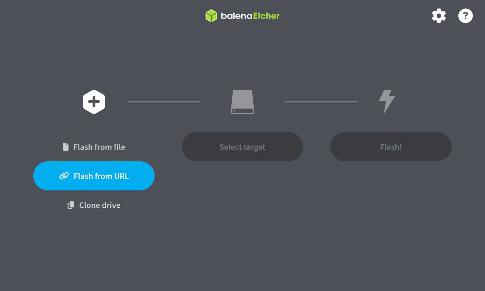
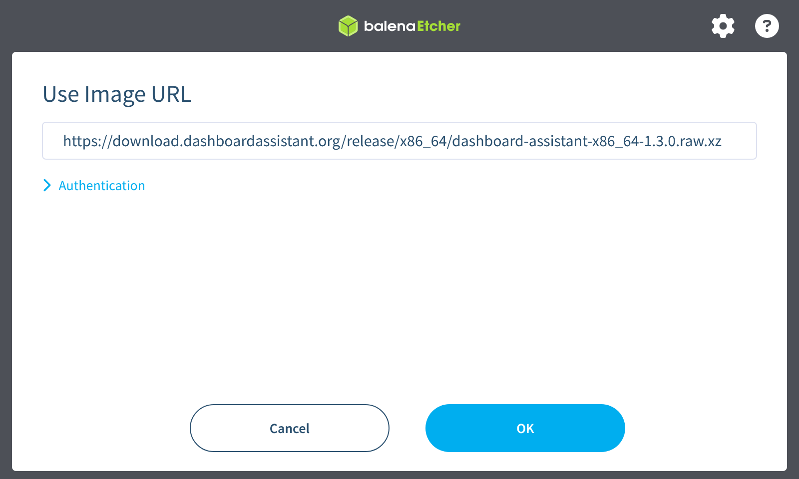
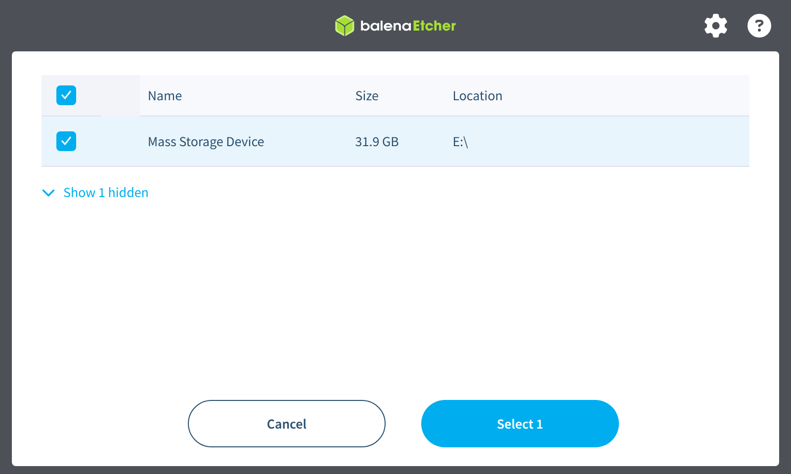
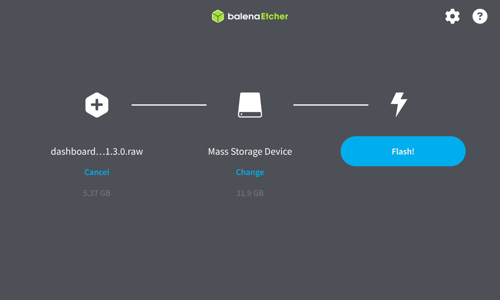

# Getting Started

Going from a spare mini-PC or Raspberry Pi to a working Home Assistant dashboard
takes four steps. Follow them in order.

## Pick your image { #download }

The current release is **1.3.0**
([release notes](https://github.com/ajfriesen/DashboardAssistant/releases/tag/v1.3.0)).
There is one image per board. **Copy address** puts the address of yours on the
clipboard; you paste it into the flashing tool in the next step.

| Board | Image | |
|---|---|---|
| x86_64 (mini-PC, NUC) | [`dashboard-assistant-x86_64-1.3.0.raw.xz`](https://download.dashboardassistant.org/release/x86_64/dashboard-assistant-x86_64-1.3.0.raw.xz) | <button type="button" class="da-btn da-btn--ghost da-btn--compact" data-clipboard-text="https://download.dashboardassistant.org/release/x86_64/dashboard-assistant-x86_64-1.3.0.raw.xz">:lucide-copy: Copy address</button> |
| Raspberry Pi 4 | [`dashboard-assistant-rpi4-1.3.0.raw.xz`](https://download.dashboardassistant.org/release/rpi4/dashboard-assistant-rpi4-1.3.0.raw.xz) | <button type="button" class="da-btn da-btn--ghost da-btn--compact" data-clipboard-text="https://download.dashboardassistant.org/release/rpi4/dashboard-assistant-rpi4-1.3.0.raw.xz">:lucide-copy: Copy address</button> |
| Raspberry Pi 5 | [`dashboard-assistant-rpi5-1.3.0.raw.xz`](https://download.dashboardassistant.org/release/rpi5/dashboard-assistant-rpi5-1.3.0.raw.xz) | <button type="button" class="da-btn da-btn--ghost da-btn--compact" data-clipboard-text="https://download.dashboardassistant.org/release/rpi5/dashboard-assistant-rpi5-1.3.0.raw.xz">:lucide-copy: Copy address</button> |

There is nothing to download by hand: the flashing tool fetches the image
itself. To keep a copy of the file anyway, follow the link in the table.
x86_64 machines need to boot **UEFI**; see the
[x86_64 requirements](hardware-support/x86.md).

## 1. Flash the image { #flash }

Flashing writes the image to the disk the device will boot from: an SD card for
a Raspberry Pi, the SSD or internal disk for an x86_64 machine. Connect that
disk to your computer with an SD-card reader, a SATA-to-USB adapter or an
NVMe/USB enclosure. If the disk cannot come out of an x86_64 machine,
[flash it from a live USB](hardware-support/x86.md#installing-onto-an-internal-disk)
instead.

!!! warning "Flashing erases the disk"
    Everything on the SD card or disk you pick is overwritten. Unplug other USB
    drives and card readers first, so the right one is the only choice.

The steps are the same on Windows, macOS and Linux.

1. Download [balenaEtcher](https://etcher.balena.io/) and start it.
2. Choose **Flash from URL**.

    { width="640" loading=lazy }

3. Paste the address of your board's image and choose **OK**.

    { width="640" loading=lazy }

4. Choose **Select target**, tick the SD card or disk to write to, and confirm
   with **Select**. Etcher hides the disk your computer runs from, so what is
   listed is what you plugged in.

    { width="640" loading=lazy }

5. Check that the image and the target are the ones you mean, then choose
   **Flash!**. Etcher downloads the image, writes it and checks the result.
   The image is several GB, so this takes a while.

    { width="640" loading=lazy }

If flashing stops partway, start it again.

On Ethernet, move the disk into the target machine (or leave it in place) and
boot it. For Wi-Fi, write a seed file first.

??? info "Raspberry Pi 4: check your bootloader EEPROM"

    Pi 5 boards need nothing special. A **Raspberry Pi 4** does: these images use a
    GPT partition table, which the Pi 4's bootloader only understands from the
    September 2020 EEPROM onwards. Any board bought since late 2020, or that has
    ever run a recent Raspberry Pi OS, is already fine.

    If a Pi 4 shows no sign of life after flashing, check its bootloader from a
    Raspberry Pi OS card:

    ```bash
    vcgencmd bootloader_version
    ```

    and update it if the date is older than `2020/09/14`:

    ```bash
    sudo rpi-eeprom-update -a && sudo reboot
    ```

    This has to be done from a Raspberry Pi OS card, not from ours: the EEPROM
    recovery file is read by a part of the chip that predates GPT support entirely,
    so a Dashboard Assistant card cannot repair a board that cannot boot it.

## 2. Get it on your network { #seed-file }

On Ethernet there is nothing to do; skip to [step 3](#integration).

For Wi-Fi you need a **seed file**: the display has no way to ask for Wi-Fi
credentials on screen, so the seed file is how they reach the device. It carries
Wi-Fi and nothing else. Once the device is on your network, Home Assistant
discovers it, and adding it there sets up the rest: its Home Assistant URL, the
login, the dashboard and the pages.

Create a file named exactly `dashboard-assistant.yaml`:

```yaml
wifi:
  ssid: "MyNetwork"
  psk: "supersecret"
```

| Key         | Description                       |
| ----------- | --------------------------------- |
| `wifi.ssid` | Wi-Fi network name to join.       |
| `wifi.psk`  | Wi-Fi pre-shared key (password).  |

Any other key is ignored.

After flashing, the card or disk carries a small FAT partition that any
computer can read: the FIRMWARE partition, labelled **`ESP`** and mounted as
`/boot` on the device. Next to the boot files it already has a **`README.txt`**
and a **`dashboard-assistant.yaml.example`**, so you can copy the example, drop
the `.example`, and edit it. Put the file in the partition's root:

=== "Linux"

    Linux desktops mount the btrfs root and leave the FIRMWARE partition
    unmounted, because they treat an EFI system partition as part of the system.
    Mount it yourself; it is the first partition, the 1 GiB one:

    ```sh
    udisksctl mount -b /dev/sdX1
    ```

    Replace `sdX` with the card or disk (`lsblk` lists it), copy the file to the
    path `udisksctl` printed, and run `udisksctl unmount -b /dev/sdX1` before
    you pull it.

=== "macOS"

    Finder shows the FIRMWARE partition as a drive named **`ESP`**; the other
    partition is btrfs, which macOS cannot read. Copy the file to the root of
    `ESP` and eject the drive before you pull it.

=== "Windows"

    File Explorer shows the FIRMWARE partition as a drive named **`ESP`**; the
    other partition is btrfs, which Windows cannot read. Copy the file to the
    root of `ESP` and eject the drive before you pull it.

    !!! warning "Name the file exactly `dashboard-assistant.yaml`"

        "Hide extensions for known file types" makes
        `dashboard-assistant.yaml.example` *look* like
        `dashboard-assistant.yaml`. Turn extensions on before renaming, or the
        device will not find the file.

**It is re-read when you change it.** The device records a checksum of the file
it last imported, so:

- **first boot**: the file is applied
- **you edit it and reboot**: the new Wi-Fi is applied. This is how you move a
  device to another network: no reflash, no factory reset
- **you leave it alone**: nothing is applied, on this or any later boot
- **you delete it**: same thing. Deleting the file does not reset anything

!!! warning "The file stays on the partition"
    Importing does not delete it, and it carries your Wi-Fi password in plain
    text, so anyone who pulls the card can read it. Delete it once the device is
    set up if that matters where the device lives.

If a device does not pick the file up, the usual cause is YAML indentation. The
device cannot show you the parse error, so compare your file against the example
above: two spaces per level, and every nested key under `wifi` indented below
it.

??? tip "Or use a USB stick"

    Put `dashboard-assistant.yaml` in the root of a normal USB stick (any
    filesystem the OS can mount) and plug it into a running device. Inserting
    the stick triggers an import immediately, so you can move a device to
    another network in the field without pulling its card.

    Unlike the FIRMWARE partition, this applies **every time you plug the stick
    in**, changed or not. There is no checksum involved.

    !!! warning "Physical access = full trust"
        Any USB stick carrying a `dashboard-assistant.yaml` is applied
        automatically, and the file carries your Wi-Fi password in plain text.
        Only use seed files on hardware and networks you control, and wipe the
        stick afterwards.

Once the file is applied, the device joins your network and shows an "add me"
screen until Home Assistant adds it.

A factory reset clears the recorded checksum, so a reset device re-imports the
seed file still sitting on its card on the next boot. That is usually what you
want when re-deploying a device. When it is not, remove the file from the
partition before resetting.

## 3. Add it to Home Assistant { #integration }

The device is managed from Home Assistant through the **Dashboard Assistant**
integration. Install it once and every device on your network shows up with its
own controls and sensors: display power, brightness, pages, screenshots, OS
updates and more (see the
[entity reference](about/features.md#home-assistant-integration)).

The integration is installed from the **Marketplace** that is built into Home
Assistant (2026.11 and later).

[](https://my.home-assistant.io/redirect/marketplace_repository/?owner=ajfriesen&repository=dashboard-assistant-integration&category=integration)

1. Click the badge above: it opens **Dashboard Assistant** in your Home
   Assistant's Marketplace. Or open **Settings → Marketplace** and search for
   **Dashboard Assistant**.
2. Install **Dashboard Assistant**.
3. **Restart Home Assistant** (**Settings → System → Restart**). The
   Marketplace only copies the files; Home Assistant loads the integration on
   restart.

After the restart, Home Assistant **discovers the device on its own** over
mDNS: a "Dashboard Assistant" card appears under
**Settings → Devices & services → Discovered**. Click **Add** and confirm. A device that has not been
paired yet hands over its API token by itself, so there is no PIN and nothing
to type. A device set up with a seed file pairs exactly the same way.

[](https://my.home-assistant.io/redirect/integrations/)

Discovery is the only way to add a device. If the card does not appear, Home
Assistant cannot see the device's mDNS announcement, usually because the two
are on different networks or VLANs.

!!! note "A device only pairs once"
    An already-paired device refuses to hand out its token again; that is what
    keeps a stranger on your network from adopting your device. To pair it with
    a new Home Assistant instance, press its **Factory reset** button first,
    which also removes its entry. A device whose entry was deleted without a
    reset has to be reflashed before it pairs again. See
    [Recovery](about/use-cases.md#recovery).

!!! info "The connection is encrypted"
    Home Assistant talks to the display over TLS, and remembers the display's
    certificate the first time it connects. Nothing on the wire is readable by
    anyone else on your network, which matters most for the Home Assistant
    login the display is given, since that is a credential to your Home
    Assistant.

    The certificate is the display's own, so there is nothing to buy, install or
    renew. If you factory-reset the display it generates a new one, and its
    Home Assistant entry stops with an error. That is expected after a reset:
    delete the entry, and the display is discovered again and pairs. If you
    have not just reset it, take a second look.

Behind the scenes, the integration creates a dedicated **non-admin Home
Assistant user** for the device (named after it, visible under
**Settings → People**) and logs the device's browser in with it, which is why the display
never shows a login screen. The user is removed again if you delete the
integration. If the [Music Assistant](about/use-cases.md#audio) add-on is installed, a
**Music Assistant** page is added to the device's page list automatically,
already signed in.

[](https://my.home-assistant.io/redirect/people/)

When a new integration release is published, the Marketplace shows an update
for **Dashboard Assistant** under **Installed**. Click **Update**, then restart Home Assistant.

[](https://my.home-assistant.io/redirect/marketplace_installed/)

## 4. Choose the pages { #pages }

Open **Settings → Devices & services → Dashboard Assistant** and click
**Configure**:

[](https://my.home-assistant.io/redirect/integration/?domain=dashboard_assistant)

- **Pages**: the pages the device shows, in order. Each page is either a
  **Home Assistant page**, picked from your dashboards and their tabs, or a
  **Website**, the address of any site. The device signs in to Home Assistant
  only, so other websites are shown signed out. Admin-only dashboards are not
  listed, because the device signs in as a regular user.
- **The first page is the device's home**: it starts there, and its **Home**
  button goes back to it. Drag a page to the top to make it the home.
- The **Page** select and the next/previous buttons switch between the pages.

Saving sends the list to the device straight away.

That's it. [Use cases](about/use-cases.md) covers the on-device controls, the
integration's entities, one-tap OS updates and rolling back if an update ever
misbehaves. If something looks off, [Recovery](about/use-cases.md#recovery) covers rolling
back and resetting the device.

[Read the use cases&nbsp;→](about/use-cases.md){ .da-btn .da-btn--ghost }
