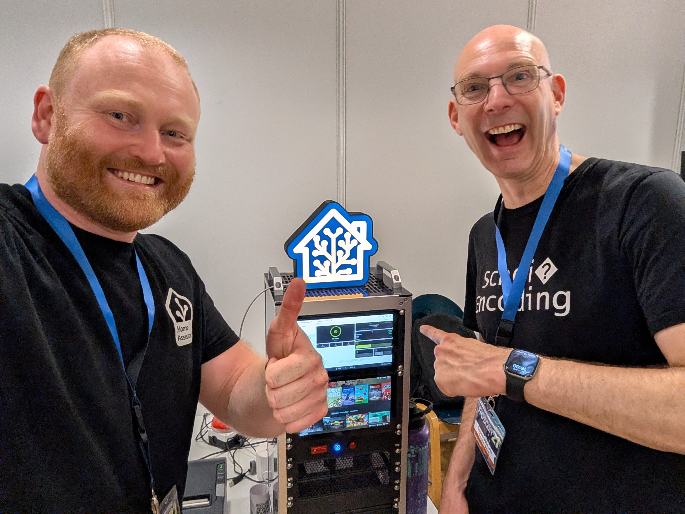

# Dashboard Assistant at FrOSCon 2026

Moin!

On 21 February 2026 I organized a Home Assistant meetup. Someone there told me
I should apply to [FrOSCon 2026](https://froscon.org/) with my [PokyPow](https://pokypow.com/) project.
So I did, and to my surprise I got a spot!

Alongside PokyPow, I showed Dashboard Assistant for the first time.

{ width="800" loading=lazy }

Thorsten from [Thorsten-Voice](https://www.thorsten-voice.de/en/) came by.

<!-- more -->