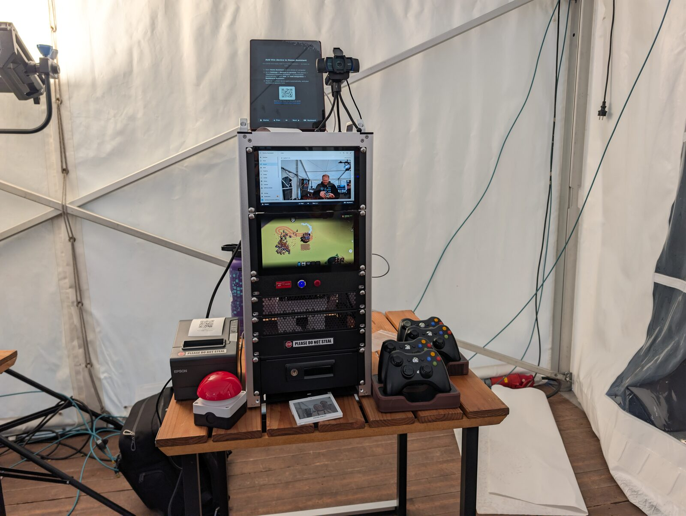

# Dashboard Assistant at Gastspiel 2026

On 14 November 2026 I took my 10-inch rack and Dashboard Assistant to
Gastspiel 2026, the event by Spiel und Zeug (Andreas Dantz). The rack shows up
in the event video from 7:50. The video is in German.

  <button type="button" class="da-video__play" aria-label="Play the video: Ich bin da in was hineingeraten: Gastspiel 2026">
    
  </button>
  
Pressing play loads the video from YouTube (Google). Or <a href="https://www.youtube.com/watch?v=uVFtGkvLsXU&t=470">watch it on YouTube</a>.

<!-- more -->

## What I showed

The rack holds my Home Assistant setup and, of course, Dashboard Assistant,
twice over:

{ width="800" loading=lazy }

- **An x86 mini-PC with GeeekPi's 9-inch rack-mount display.** The display
  connects over plain HDMI, with touch over USB.
- **A Raspberry Pi 5 with the official
  [Raspberry Pi Touch Display 2](../../hardware-support/touchscreens.md)
  (10 inch).**

On the Raspberry Pi I ran the onboarding more times than I can count: boot the
device, one click, and it's in Home Assistant. Then a factory reset and start
over.

## Feedback

I got a lot of good feedback, and some fair criticism too. One example: when
you switch pages, the kiosk simply loads the page's URL again, so it doesn't
remember deep navigation or the scroll position. That hurts when you have a
recipe open, pop over to Music Assistant for a moment and want to come back.

